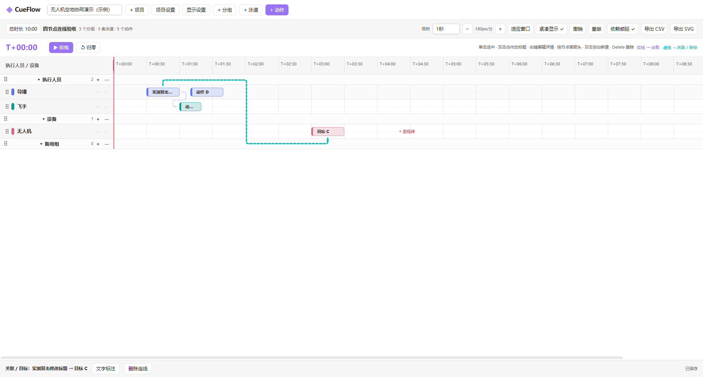

# CueFlow Timeline

**Plan a live demonstration in Obsidian with a seconds-based timeline for people, equipment and actions.**

[中文首页](README.md) · [Download 0.10.0](https://github.com/dzdanielzhang-rgb/CueFlow/releases/tag/0.10.0) · [User guide (Chinese)](docs/USER_GUIDE.md) · [Issues](https://github.com/dzdanielzhang-rgb/CueFlow/issues)

CueFlow is a local-first Obsidian desktop plugin for presentations, stage operations, multi-device demonstrations and run-of-show planning. Organize resources into groups and lanes, drag actions on a relative timeline, and connect actions with dependencies, synchronization or visual associations. The interface is currently in Chinese.

## Features

- Integer-second scheduling, configurable duration up to 24 hours, zoom, snapping and compact lanes.
- Custom groups and lanes, lane moves across groups, group reordering and resizable resource labels.
- Inline action titles, detail editing, move/resize, alignment guides, marquee selection and batch transforms.
- Finish-to-start dependencies; equal-start and equal-finish synchronization; non-scheduling visual associations.
- Connection labels, close-gap routing, horizontal obstacle avoidance and vertical lines behind opaque action cards.
- Ctrl+C/V at the mouse position, preserving relative layout and internal relationships while dropping external references.
- Critical action stars, milestones, rehearsal clock, save-conflict handling and per-view undo/redo.
- Full JSON/Markdown import/export for external AI round trips, plus CSV schedules and SVG charts.

## Install

1. Download `cueflow-plugin-v0.10.0.zip` from the release page.
2. Extract it into your vault so these files are directly inside `.obsidian/plugins/cueflow-timeline/`: `main.js`, `manifest.json`, `styles.css`.
3. Restart Obsidian and enable **CueFlow Timeline** in Community plugins.
4. Use the sidebar clock icon or search for `打开演示脚本时间轴` in the command palette. A sample project is created on first use.

No npm, account, API key or other task plugin is required. The GitHub **Source code** archive is a source snapshot; the named plugin ZIP is the installation package. See the [installation guide](docs/INSTALLATION.md) for upgrades and rollback.

## Essential controls

| Action | Control |
|---|---|
| Select / multi-select | Click; Ctrl+click; drag a marquee on lane background |
| Create action / rename | Double-click lane background / double-click action |
| Edit details | Right-click action → 编辑详情 |
| Move / resize | Drag the center / edges; selected actions transform together |
| Copy / paste | Ctrl+C, hover a visible destination lane and time, Ctrl+V |
| Delete / undo / redo | Delete / Ctrl+Z / Ctrl+Shift+Z |
| Dependency | Right port to left port |
| Equal start / finish | Left to left / right to right |
| Visual association | Top/bottom to top/bottom |
| Edit connection text | Double-click a visible connection segment |

Synchronization remains active when automatic dependency scheduling is off. Contradictory timing constraints are rejected. Text inputs keep their normal clipboard and editing behavior. Command is supported by the keyboard handlers on macOS, but equivalent macOS testing has not been completed.

## Data and support

Projects are Markdown files in the vault (default folder: `CueFlow/`). Portable project files preserve all actions, groups, lanes, notes, dependencies, synchronization links, labels and critical markers. AI optimization is performed by an external tool chosen by the user; CueFlow does not include remote AI calls or telemetry upload.

Current release: **0.10.0**. Declared minimum Obsidian version: **1.5.0**. Tested client: **Windows / Obsidian 1.14.4**. Desktop only; macOS/Linux have not received equivalent client validation. Project schema is **5**, portable package format is **cueflow.project / 1**. Back up both project files and plugin files before upgrading; restore both when rolling back to 0.9.1 or earlier.

This release passed targeted local checks and 23 client checks, including real copy/paste shortcuts; a full regression suite was not rerun. See [validation](docs/VALIDATION.md). Frame-level timing, live collaboration and automatic equipment control are outside the current scope.

## Documentation and contribution

- [Complete user guide](docs/USER_GUIDE.md), [shortcuts](docs/SHORTCUTS.md), [troubleshooting](docs/TROUBLESHOOTING.md).
- [Portable files and AI workflow](docs/PROJECT_FILES.md), [examples](examples/), [changelog](CHANGELOG.md).
- [Contributing](CONTRIBUTING.md), [release procedure](docs/RELEASING.md).

Licensed under [MIT](LICENSE).
