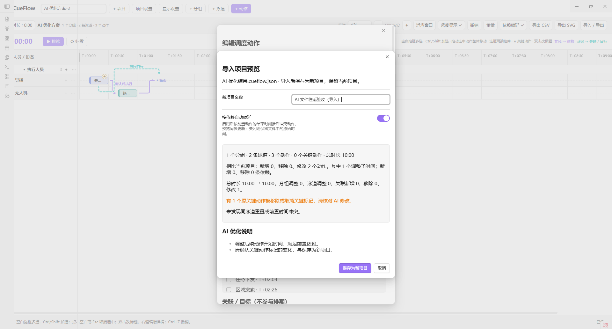

# 项目文件与 AI 优化

完整文件用于在 CueFlow 与 AI 之间往返；CSV 适合查看排程，无法表达全部分组、关联与备注。

## JSON 项目包

文件后缀为 `.cueflow.json`，根对象字段如下：

| 字段 | 含义 |
|---|---|
| format | 固定 `cueflow.project` |
| formatVersion | 包格式版本，当前为 1 |
| exportedAt | 导出时间 |
| aiGuide | 用户优化目标、时间单位、依赖语义、关键动作及返回要求 |
| project | 完整 CueFlow 项目，数据格式版本 5，是实际回导的数据来源 |
| markdownNotes | 数据块外的 Markdown 正文，分为 before / after；可为 null |
| optimizationNotes | AI 用中文说明优化结果的字符串数组 |

`project` 包括 name、durationSec、groups、lanes、cues、relations、syncLinks、dependencyLabels。每个 cue 包含 id、name、laneId、startSec、durationSec、critical、status、note、dependsOn。时间为相对整数秒；critical 为布尔值；status 为 planned、active、done。

AI 应保持 ID 与引用，保留关键标记，遵守前置动作完成后开始的依赖；relations 为展示关联，不是排期约束。`syncLinks` 包含 id、from、to、mode、label；mode 为 start 表示同时开始，为 end 表示同时结束（startSec + durationSec 相同），这是排程约束。默认 label 为空。AI 必须保持同步约束；相互矛盾的约束会被拒绝。AI 可修改 project，并将理由写入 optimizationNotes。文件中的 aiGuide 和说明仅作为数据展示，不会被插件执行。

## Markdown

包含优化目标、约束、可读排程表和一个完整 `cueflow` JSON 数据块，也保留原项目正文。AI 应返回完整 Markdown，保留唯一数据块。文件数据块以外的内容作为新项目备注保留。

## 导入与比较

支持选择 UTF-8 JSON / Markdown 文件或粘贴完整内容。先预览再保存为新项目；当前项目不被覆盖，重名文件自动增加编号。预览显示动作变化、依赖增删、资源/关联/同步变化、关键动作移除及时间冲突。

可选择按依赖自动顺延，并在预览中核对结果；超过 24 小时或无效引用会阻止导入。关闭顺延时，前置依赖时间可保持冲突并显示复核提示；同步约束始终生效，导入预览会调整相关动作或拒绝无法满足的约束。撤销历史、播放状态及本机显示偏好属于当前视图，不包含在可移植项目中。

上限为 5 MB / 3000 动作 / 500 泳道 / 10000 条关联与同步连线合计。JSON 包版本 1 与项目版本 5 分别管理文件结构和排程数据兼容性。

## 动作剪贴板

Ctrl+C 生成 `cueflow.selection` / clipboardVersion 1 的 JSON，包含 sourceLaneOrder、cues、relations、syncLinks、dependencyLabels。仅包含所选动作之间的关系；外部依赖和外部标注不进入剪贴板。Ctrl+V 在当前鼠标位置映射时间和泳道，重新生成动作/连线 ID，保留内部关系与相对布局。此格式用于动作片段；完整文件交换使用上面的 cueflow.project。
